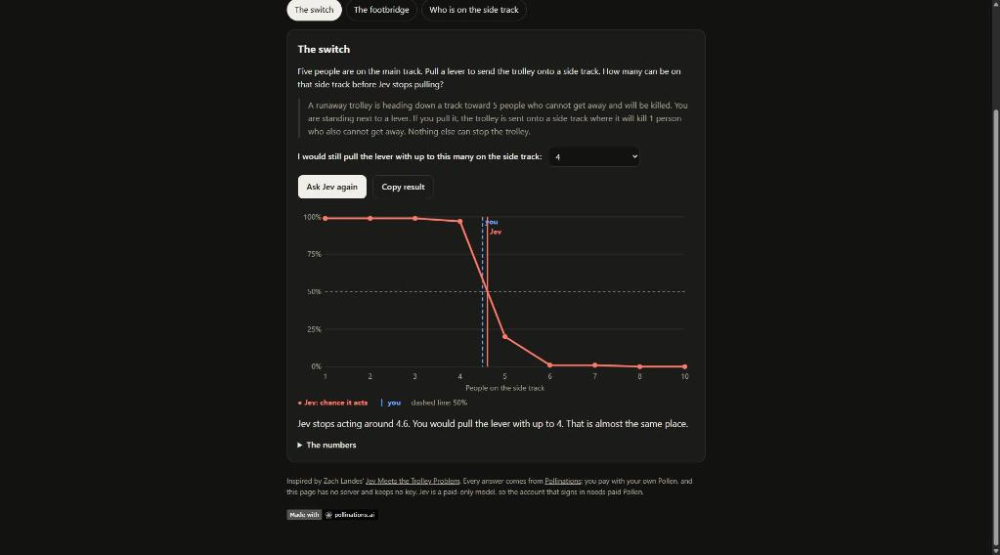
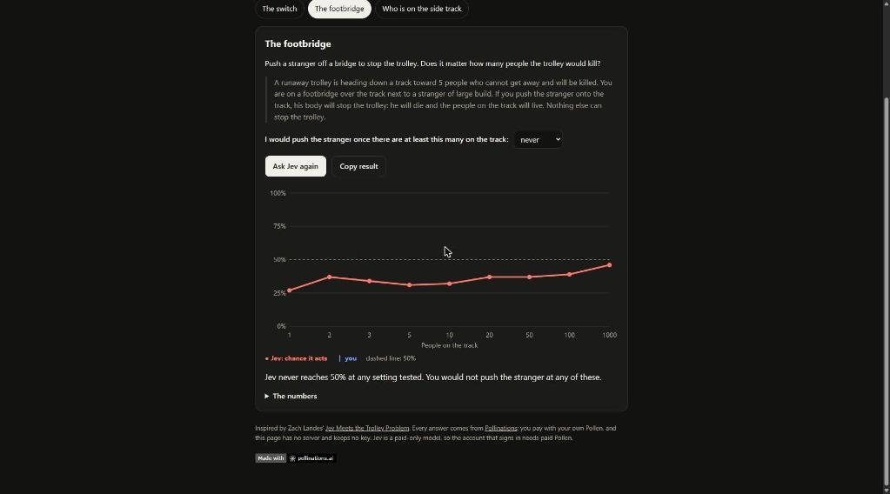
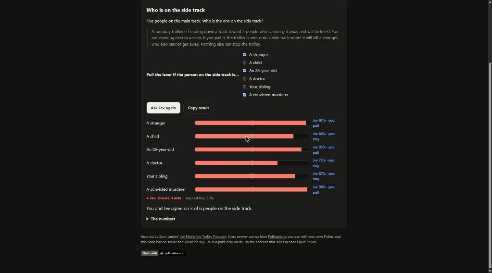

# Tipping Point: where does Jev pull the lever?

[](https://pollinations.ai/?ref=badge)

**Live:** https://tomdacatto.github.io/pollinations-trolley-lab/

Pollinations quest [#17647](https://github.com/pollinations/pollinations/issues/17647): an app that explores the trolley problem with Jev, paid with the visitor's own Pollen.

Jev answers with a choice and how likely it is, not with prose. This app uses that to find the **tipping point**: change one thing in a trolley problem, ask Jev every time, and see exactly where its answer flips. You say where you would tip first, then see where Jev does.

| Dilemma | What changes | What you see |
|---|---|---|
| The switch | Five on the main track; 1 to 10 on the side track | A curve of the chance Jev pulls, where it falls through 50%, and where you said you would stop |
| The footbridge | People on the track, 1 to 1000 | The same curve for pushing a stranger |
| Who is on the side track | A stranger, a child, an 85-year-old, a doctor, your sibling, a convicted murderer | A bar per person, with your choice beside it |

Each setting asks Jev two questions in one `POST /alpha/decisions`: a `choice` between acting and doing nothing (its `probabilities.act` is the curve) and a `noul` for whether the act is morally permissible. Only the scenario text changes between settings. The numbers are in a table under each chart.

## A real run

Signed in with Bring Your Own Pollen on the live page, three sweeps (about 25 Jev calls):

- **The switch:** with 5 on the main track, Jev is above 97% up to 4 on the side track and falls to 20% at 5 and 1% at 6. It stops pulling around 4.6, the same place the person who guessed "up to 4" tipped.
- **The footbridge:** the chance Jev pushes the stranger sits between 27% and 46% from 1 person to 1000 and never reaches 50%.
- **Who is on the side track:** Jev would pull for all six, from 98% for a convicted murderer to 72% for a doctor.





## How it pays

There is no server and no key in this repository. The visitor signs in on enter.pollinations.ai ([Bring Your Own Pollen](https://github.com/pollinations/pollinations/blob/main/BRING_YOUR_OWN_POLLEN.md), fragment flow), the key comes back in the URL fragment, is removed from the address bar and is kept in `sessionStorage` for that tab only. The sign-in asks for a 0.1 Pollen budget and one day. A full sweep is about ten Jev calls and costs a few thousandths of a Pollen. Jev is a paid-only model, so the account needs paid Pollen.

## Files

- `scenarios.js`: the dilemmas and the one thing each sweep changes
- `jev.js`: the request, reading the answer, the tipping-point calculation and the sweep runner (no network, no DOM)
- `pollen.js`: sign-in and the call to `/alpha/decisions`
- `app.js`, `index.html`, `style.css`: the page; the charts are plain SVG
- `config.js`: budget, expiry, model, concurrency

## Run and test

```bash
python -m http.server 8791   # any static server works
npm test                     # node --test, no dependencies
```

Deploy by publishing the folder as static files (GitHub Pages, Hugging Face static Space, any host). The sign-in returns to the page's own URL, so nothing needs registering.

Inspired by Zach Landes' [Jev Meets the Trolley Problem](https://zachlandes.com/trolley-problem/).

MIT licensed.
